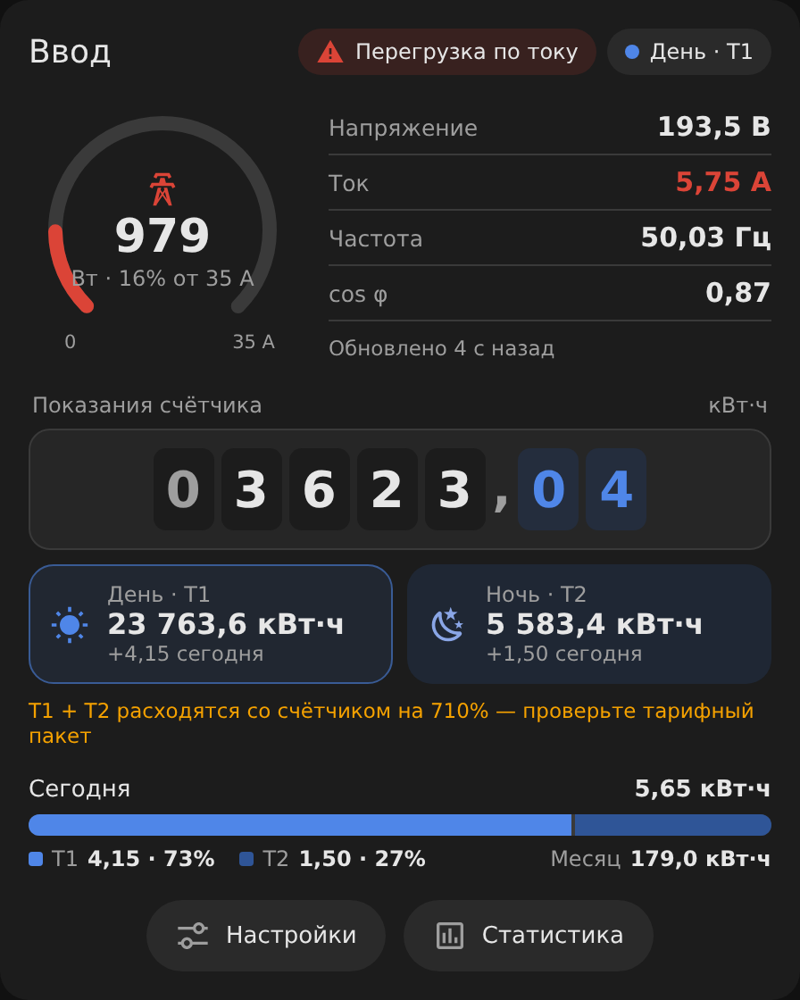
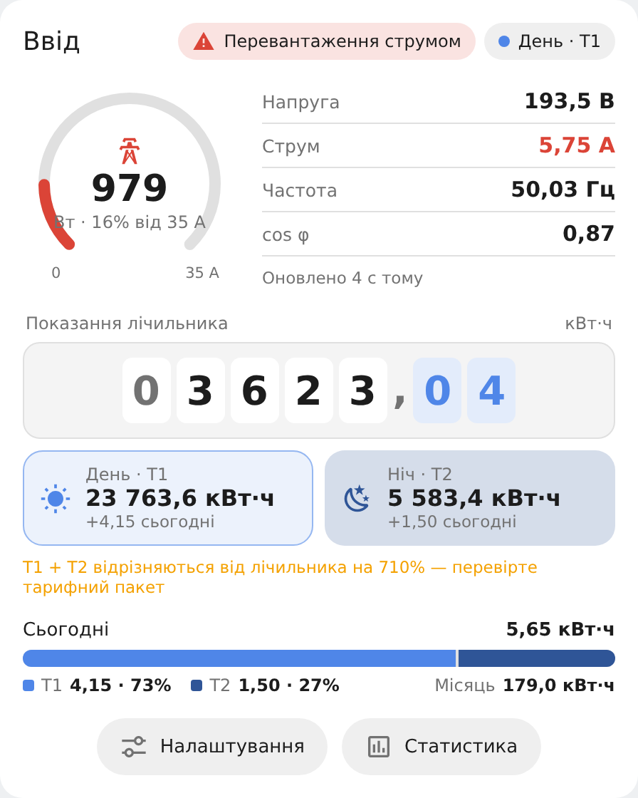
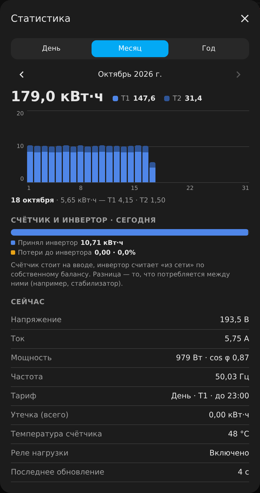
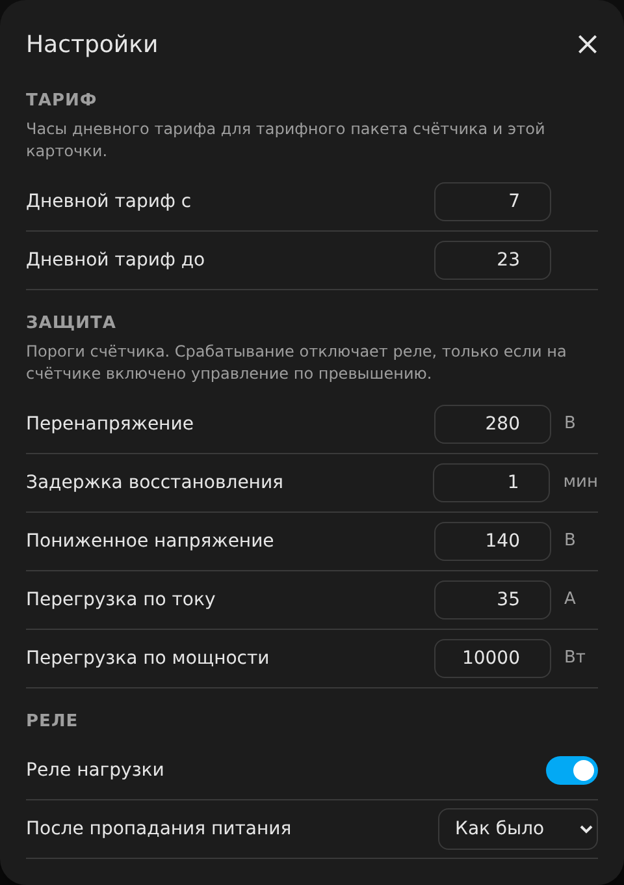

# Energy Meter Card

A Home Assistant Lovelace card for a mains energy meter — a Tuya DIN meter such as
GR2PWS flashed with ESPHome — styled to match
[eybond-inverter-card](https://github.com/pollstar/ha-eybond-local).

<p>
  
  
</p>

## What it shows

- **Gauge** — current against the main breaker rating (the breaker trips on current, not
  power), with power in the middle; voltage, current, frequency and cos φ beside it.
- **Meter reading** as an odometer, plus the cumulative day (T1) and night (T2) counters.
- **Today** — T1/T2 split for today and the month total.
- **States** — protection trips (overcurrent, overpower, over/undervoltage, leakage),
  relay off, no voltage on the input, and *stale data*: when the meter stops reporting
  (no voltage update for `stale_after` seconds) the values turn grey and a chip says
  how long ago the last data came.
- **Statistics** — day / month / year history stacked by tariff, a meter-vs-inverter
  balance for today (with `inverter:` set) and all live values.
- **Settings** — tariff hours, protection thresholds, the load relay (switching it off
  needs a second tap) and its power-on state.

<p>
  
  
</p>

### How T1/T2 are counted

Energy for a period (today, a day, a month, a year) is taken from Home Assistant's
long-term statistics of the **total energy** sensor and split by the tariff hours
(`number.*_t1_start_hour` / `t1_end_hour`, default 07–23). The periods therefore always
add up to the meter itself. The cumulative T1/T2 counters are shown as the meter's tariff
package reports them; if their sum differs from the meter by more than 1 %, the card says so.
When T1/T2 are seeded from the utility's two-rate meter (so they will never add up to this
meter), set `tariff_check: false`.

Statistics need the recorder and `state_class: total_increasing` on the total energy sensor.

## Install

HACS → ⋮ → Custom repositories → `https://github.com/pollstar/ha-energy-meter-card`,
type **Dashboard**. Install *Energy Meter Card* and reload the browser.

## Configuration

```yaml
type: custom:energy-meter-card
device: cb2s            # object-id prefix of the meter's entities; auto-detected
title: Ввод             # optional
breaker: 40             # gauge scale, A; default: the meter's overcurrent threshold, else 40
inverter: pi30_6200     # optional, eybond_local prefix for the balance in Statistics
stale_after: 120        # seconds without a voltage update before values are stale
show_controls: true     # Settings button
tariff_check: true      # warn when T1 + T2 differ from the meter (off if seeded from the utility meter)
theme: auto             # auto | light | dark
entities:               # optional per-entity overrides
  total: sensor.cb2s_total_energy
```

Default entities for `device: cb2s`:

| key | entity |
|---|---|
| power, voltage, current | `sensor.cb2s_power`, `sensor.cb2s_voltage`, `sensor.cb2s_current` |
| frequency, power_factor | `sensor.cb2s_current_frequency`, `sensor.cb2s_power_factor` |
| total, t1, t2 | `sensor.cb2s_total_energy`, `sensor.cb2s_energy_t1_day`, `sensor.cb2s_energy_t2_night` |
| tariff | `sensor.cb2s_current_tariff` (1 = day, 2 = night) |
| leakage, cpu_temp | `sensor.cb2s_leakage_total_energy`, `sensor.cb2s_cpu_temp` |
| relay, power_on_state | `switch.cb2s_switch_1`, `select.cb2s_power_on_switch_status` |
| t1_start, t1_end | `number.cb2s_t1_start_hour`, `number.cb2s_t1_end_hour` |
| ovp, lvp, ocp, opp, recovery | `number.cb2s_overvoltage_protection_value`, `…_low_voltage_protection`, `…_overcurrent_protection_value`, `…_overpower_protection_value`, `…_over_voltage_recovery_delay` |
| w_ovp, w_lvp, w_ocp, w_opp, w_le, w_olcp | `binary_sensor.cb2s_warning_*` |

Missing entities are simply left out.

Language follows the Home Assistant UI: English, Ukrainian, Russian.
